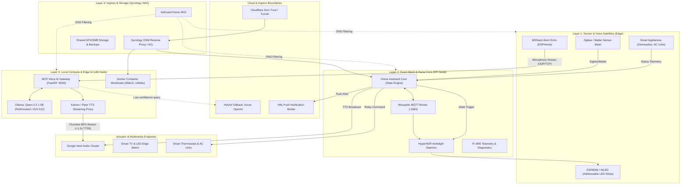
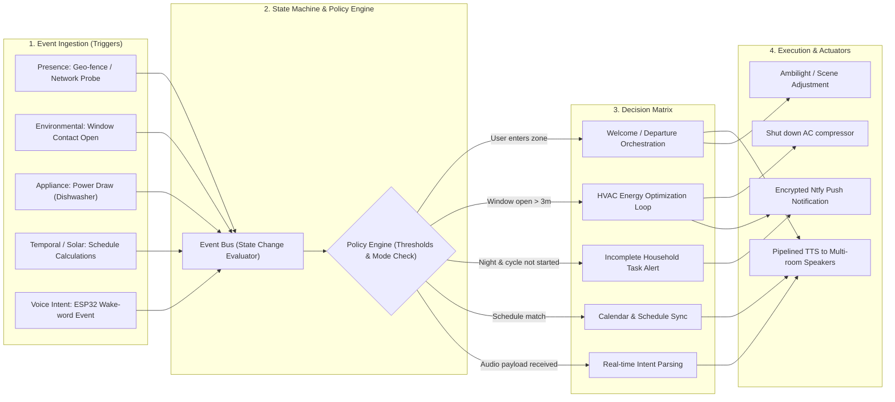
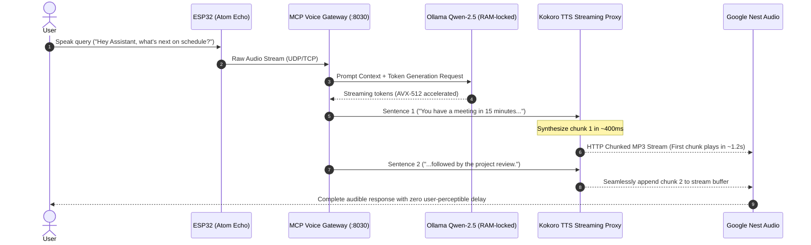

# Edge Platform & Automation Architecture

> Platform Solution Architecture Blueprint: Edge Computing, Distributed Event Mesh & Local AI Pipeline

This repository contains the architecture diagrams, automation state models, and design documentation for a distributed edge platform running across microcontrollers, single-board orchestrators (Raspberry Pi), and localized x86 compute.

---

## 1. Global Platform Architecture (C4 Container View)

---

## 2. Automation Engine & Event Mesh

This diagram illustrates how physical, temporal, and user-initiated state changes are ingested, evaluated by policy constraints, and dispatched across actuation endpoints.

---

## 3. Sub-Second Streaming Voice AI Pipeline (Sequence Diagram)

---

## 4. Architectural Decision Records (ADRs)

| Architectural Decision | Chosen Strategy | Technical Rationale |
| :--- | :--- | :--- |
| **Workload Partitioning** | Tiered (Microcontrollers $\rightarrow$ SBC $\rightarrow$ x86) | Isolate low-jitter real-time I/O from heavy compute; prevents LLM inference workloads from locking Home Assistant core events. |
| **Local Model Serving** | In-Memory Locked Ollama (`qwen2.5:1.5b`) | Eliminates cold-start disk swapping latency; satisfies sub-1.5s voice turnaround budget. |
| **Audio Latency Budget** | Sentence-chunked MP3 HTTP streaming proxy | Eliminates the need to wait for complete paragraph synthesis before beginning audio playback on target endpoints. |
| **Zero-Trust Ingress** | Synology DSM Proxy + Cloudflare Access | Restricts internal management consoles and status metrics behind authenticated proxy layers with strict subnet ACLs. |
| **Event Messaging** | MQTT + Decoupled Ntfy | Asynchronous publish-subscribe model decouples producers from consumers, eliminating cascading network failures. |
